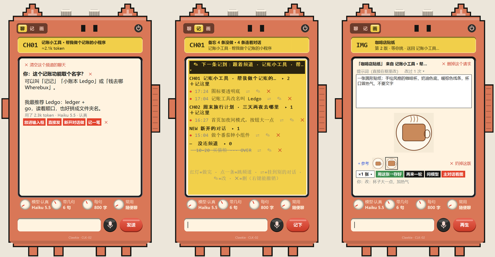
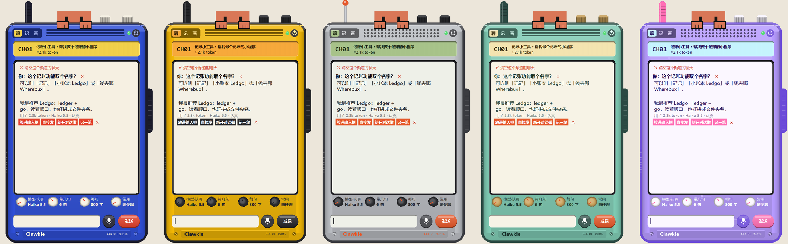

# 克讲机 Clawkie

**Claude Code 旁边的一台桌面对讲机。** 做项目做到一半想问点小事（取个名字、查个词、改一句话），不用在主对话里问：对讲机用便宜的模型，只带你当前对话的最后几句；满意了一键交回主对话，不打断它。还能记备忘（挂在对应的对话下面）、开生图台。

[English](README.md)

> **作者在找工作！** 有机会请联系：[领英](https://www.linkedin.com/in/miaomiao-yang-331901383) · 小红书 @羊猫猫不是猫 · [更多联系方式](#联系作者)



作者 **Miaomiao**（GitHub [@Miaomiaomeowmeow](https://github.com/Miaomiaomeowmeow)）· 许可 [CC BY-NC-SA 4.0](LICENSE)（可以改，改了要同样公开，不准商用）· 只支持 Windows

名字的梗：对讲机 → 克讲机；walkie-talkie → Clawkie-talkie（读“克劳-基”）。

## 为什么做它

主对话正在干活，你想问个跟项目关系不大的小事。在主对话里问，要带上整段很长的上下文（费 token），还打断它。所以做一个小窗：便宜的模型、只带最后几句、两边同时进行；主对话看不到这里，除非你自己点按钮交过去。

## 有什么

一台对讲机，三个档位（左上角的拨杆：**聊 / 记 / 画**）。外壳、频道、通话键三档共用。

| 档 | 屏幕里是什么 | 底下输入框干嘛 |
|---|---|---|
| **聊** | 和便宜模型的聊天（默认 Haiku）。每条回答下面：放进输入框（看过再发）/ 直接发（替你发给主对话，它马上接着做）/ 新开对话做 / 记一笔 | 问一句 |
| **记** | 通联日志屏：备忘按频道（对话）分组。红灯 = 没做完，点一下 = 做完（划掉写 OVER）；点一条跳到它的对话；⇄ 挂到别的对话（侧边栏里没开着的也行）；✎ 改；✕ 删（右键能撤销） | 记一条（默认记到现在的频道；最上面黑底那条写着下一条记到哪，点开能换） |
| **画** | 一个大提示词框（直接在框里改）、现在这张图、参考图和每一版小图。按钮：×N 张 / 用这张→存好 / 再来一轮 / 问模型（把你的不满意改写成新提示词）/ 主对话看图 | 说哪里不满意，回车 = 在选中那版上改 |

- **频道（CH01、CH02…）** = 装了插件的 Claude Code 对话。顶上左旋钮或背光屏换频道；显示的是你侧边栏里的对话名。
- **四个旋钮**：模型 · 带几句（不带～50 句）· 每句几字 · 常用功能（取名字 / 解释个词 / 改一句话 / 自己建，在 `talkie/presets/`）。模型旋钮里还能选想得多认真（快 / 一般 / 认真 / 很认真 / 最认真）和能不能上网查（必应，插件去查，一次回答最多查 4 次）。
- **按住说话**：按住麦克风键（或侧面通话键）说，用的是 Windows 自带的语音输入（Win+H）；松手字留在输入框里，你看过再发。
- **六种机身**（顶上右旋钮）：小克机（耳朵是天线、眼睛是指示灯、右手是通话键）+ 五种真对讲机外壳，小克趴在顶上：扑克钴蓝 / 户外黄 / 80 年代银灰 / 薄荷复古 / Y2K 糖果紫。代码画的，拉多大都清楚。



- **主对话交活过来**：主对话里的 Claude 要生图时，可以调插件的工具 `mcp__clawkie__image` 把活交给生图台，自己接着干；`mcp__clawkie__image_prompt` 能把改好的提示词推到卡上。定稿「存好」只留一张小纸条，等你下次在那个对话说话时顺带告诉它，不单独打扰。
- 能删的都看得见（聊天、整个频道、备忘、图的版本、请求、常用功能），大多数右键能撤销。

## 怎么做的

两半，靠 `~/.claude/clawkie-bridge/` 里几个小 JSON 文件说话：

- **`clawkie/`** 是 Claude Code 的插件：每 3 秒报到“我在线”，读自己这个对话的最后几句，用这个对话自己的账号问模型（`$.model.complete`，不用另外登录、不用 Key），把答案写回来；还能往主对话输入框里填字 / 直接发、新开对话、注册两个生图工具。
- **`talkie/`** 是 Python tkinter 小窗：自己不调 AI，把问题写进传话文件夹，插件来答。生图用电脑上的 **Codex CLI**（`codex exec`），花 Codex 的额度不花 Claude 的。

| `~/.claude/clawkie-bridge/` 里的文件 | 谁写 | 是什么 |
|---|---|---|
| `live-<对话>.json` | 插件，每 3 秒 | 我在线、叫什么、带几句大约多少 token |
| `ask-` / `answer-<对话>.json` | 小窗 / 插件 | 问题（+ 设置、小窗最近 6 句）/ 答案 |
| `tell-` / `told-<对话>.json` | 小窗 / 插件 | 交给对话：放进输入框 / 直接发 / 新开对话 / 留小纸条 |
| `img-req-*.json`、`img-upd-*.json` | 插件 | 生图请求 / 推来的新提示词 |
| `images/<编号>/v1.png…` | 小窗 | 每一版图 |
| `talkie.json` | 小窗 | 设置、位置、聊天、备忘、生图记录（你的数据在这里，不在仓库里） |
| `notice.json`、`pet-pose.json`、`focus.json` | 小窗 / 插件 | 给可选的桌宠 ClawdPet 用 |

## 需要什么

- Windows 10 / 11
- **Claude 桌面应用**里的 Claude Code（能装插件 / mod）
- **Python 3.10+** 和 **Pillow**（`pip install pillow`）；python.org 下载的 Python 自带 tkinter
- 可选：**Codex CLI**（装在 `%LOCALAPPDATA%\OpenAI\Codex\bin`），画档要用；没装的话聊和记照用，画档会说找不到 Codex
- 可选：[小克桌宠 ClawdPet](https://github.com/Miaomiaomeowmeow/clawd-pet)：小克手里拿一台迷你对讲机，双击它打开克讲机，长按 = 按住说话，你点进欠着备忘的对话时它会提醒

## 安装

1. 下载这个仓库（Code → Download ZIP），解压到一个不会再挪的地方。
2. 装插件：把 `clawkie` 文件夹复制到 `%USERPROFILE%\.claude\skills\clawkie`（复制完应该有 `...\skills\clawkie\hooks\register.tsx`）。新开的对话会自动带上（`claude plugin details clawkie` 能看到 `clawkie@skills-dir`）；已经开着的对话要重开。
3. `pip install pillow`
4. 双击 `talkie\start.bat`。对讲机出现在屏幕右下角：拖机身空白处挪位置，拖四条边改大小，右键是菜单，电源键收起。只开一个，再开一次只是把它叫到前面。

**不想自己弄？** 把 `AI-SETUP.md` 给你的 AI 助手（Claude Code、Codex、Cursor……都行），说“照 AI-SETUP.md 帮我装克讲机”。它会先检查 Python、Pillow、插件文件夹、Codex，一次问你一题，最后给你做个桌面快捷方式。

**和桌宠连上**：先开一次克讲机（它会在 `~/.clawd/talkie.json` 留一张名片），然后在 ClawdPet 右键菜单里打开「克讲机」，或在桌宠文件夹里运行 `python pet.py link talkie on`。反过来克讲机会借桌宠的画法，顶上的小克穿什么跟桌宠一样。

## 常用功能

`talkie/presets/` 里一个 Markdown 文件 = 旋钮里一个常用功能。第一行是名字，剩下的是加在模型说明后面的规矩。在对讲机里也能新建、改、删（删的放进 `presets/deleted/`）。第二行写 `来自：<文件>｜<段落名>` 可以从别的文件里读一段带标记的规矩，主对话也要用的规矩就只写一份。写法见 `talkie/presets/README.md`。

## 已知的限制

- 界面只有中文（英文界面在愿望清单里）。
- 语音打字的速度就是 Windows 自带语音输入的速度。
- 生图只接了 Codex CLI。
- 手机上（Claude 手机 App）插件面板只会说“回电脑上用”。

## 文件

```
clawkie/            Claude Code 插件（hooks/register.tsx 是主体；tests/ 有 12 个自动测试）
talkie/
  clawkie_talkie.py 小窗：三档、频道、备忘、生图台、语音
  skin.py           六种机身，用 Pillow 画
  presets/          常用功能
  start.bat         双击打开
  clawkie.ico / clawkie-icon.png   图标（是在生图台上自己生的）
docs/screenshots/   上面的图（示例数据）
AI-SETUP.md         给 AI 助手看的安装向导
```

测插件：`claude plugin validate clawkie`、`claude plugin test clawkie`。

## 联系作者

Miaomiao · GitHub [@Miaomiaomeowmeow](https://github.com/Miaomiaomeowmeow) · [领英](https://www.linkedin.com/in/miaomiao-yang-331901383) · 小红书 @羊猫猫不是猫

在克讲机上做了什么新东西，很希望你告诉我。

小克 Clawd 是 Claude Code 的吉祥物；这是非官方的粉丝项目，和 Anthropic 无关。
